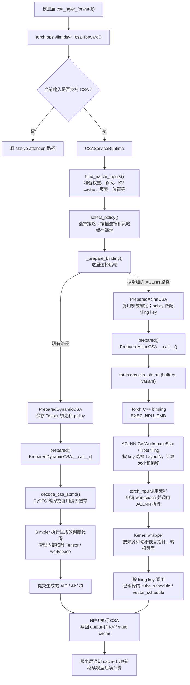

# CSA 接入调用链示意图

本文对照现有 Python PTO 模型接入与拟增加的 ACLNN 后端。
右侧 ACLNN 单算子工程已经存在；将它接入同事的模型分支仍是方案，不能据此认为整模型接入已完成。

## 怎么理解这个替换

- **分叉前复用**：模型路由、Native 参数准备、policy、绑定缓存和图合同。
- **Python PTO 路径**：PyPTO/Simpler 管理编译、提交和内部临时内存。
- **ACLNN 路径**：Host 计算布局，调用框架申请 workspace，内核包装层按偏移传参。
- `PreparedAclnnCSA` 内部仍调用 `PreparedDynamicCSA` 准备参数和 policy，但不调用它的 `__call__()`；替换的是执行路径，不是重写所有参数准备逻辑。
- 图展示准备及普通执行流程。绑定可缓存、同描述符输入可 rebind；图捕获后的 replay 不会每次重新走所有 Python 步骤。
- 当前 ACLNN 适配使用带 Top-K 输出的诊断合同，会在准备阶段补齐两张 Top-K 输出；不能把它与 Python 正常入口的 55 Tensor 合同直接混同。

## 关键代码位置

同事模型分支（只读参考，不在本次文档工作中修改）：

`/data00/wangkai/pto_env/xllm-vllm-ascend`

- `vllm_ascend/models/pypto_deepseek_v4.py`：模型层接管入口。
- `vllm_ascend/ops/dsv4_csa.py`：CSA 路由与 Native 回退。
- `vllm_ascend/ops/pypto/deepseek_v4_flash_csa_spmd_tnd/service.py`：参数准备、策略、绑定缓存与 `_prepare_binding()`。

当前 ACLNN 工程：

- [runtime.py](runtime.py)：`PreparedAclnnCSA`，policy 精确匹配 tiling key，调用 Torch 算子。
- [torch/binding.cpp](torch/binding.cpp)：`EXEC_NPU_CMD` 接入。
- [op_host/csa_spmd_tnd_pto.cpp](op_host/csa_spmd_tnd_pto.cpp)：Host tiling 和 workspace 大小申报。
- [include/layout_generated.h](include/layout_generated.h)：动态布局公式。
- [op_kernel/csa_spmd_tnd_pto.cpp](op_kernel/csa_spmd_tnd_pto.cpp)：按偏移恢复指针，选择生成核。

## 尚需完成的模型接入工作

增加可选择的 ACLNN 后端、加载 vendor/Torch 扩展、调整后端初始化，并验证真实权重、cache 原地更新、warmup、rebind 和图捕获/重放。不应只替换构造函数就宣称整模型接入完成。
