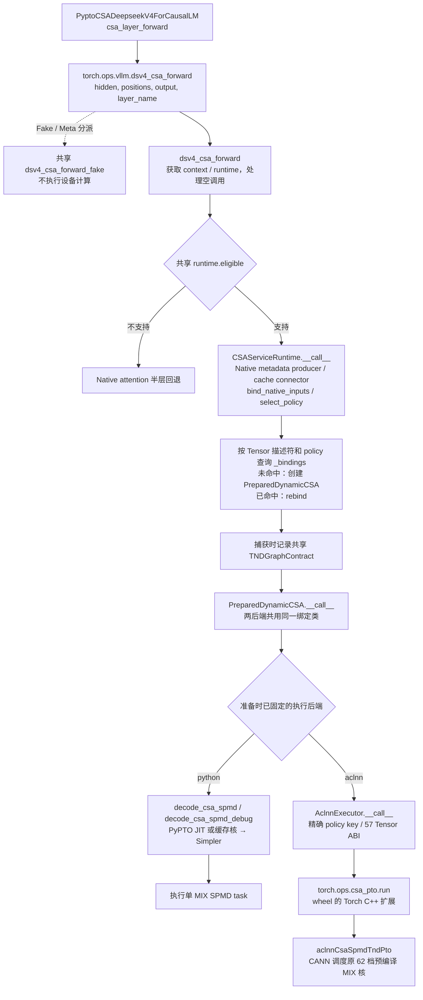
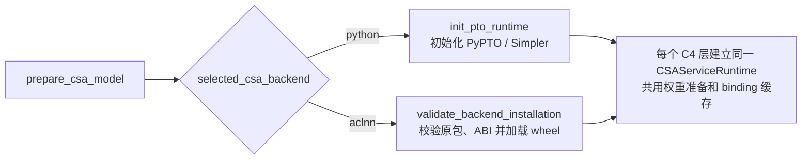

# CSA TND-SPMD 的 Python / ACLNN 可选执行后端

本次先打通原 62 档 ACLNN 包的完整接入流程。设备代码、Host tiling、MIX
包装与 wheel 打包脚本直接来自
[`caed2c32896ddefdbcfab180b253d777bfab11e0`](https://github.com/mihudaner/vllm-ascend/tree/caed2c32896ddefdbcfab180b253d777bfab11e0/examples/csa_spmd_tnd_aclnn)。
构建 wheel 没有重新运行 PyPTO/PTOAS 生成核，也没有修改其算法源码。

## 安装与选择

使用与目标服务匹配的 Python/Torch/TorchNPU/CANN 环境安装本机产物：

```bash
python -m pip install --force-reinstall --no-deps /path/to/csa_pto_ops-0.1.0-cp310-cp310-linux_aarch64.whl
```

本机 wheel 位于工作区
`downloads/csa_aclnn_backend_20261028/`；同目录的 `BUILD_PROVENANCE.json`
记录来源、工具链、构建命令、二进制与 wheel 哈希。
本包匹配 Python 3.10、aarch64、Torch 2.10.0+cpu、TorchNPU 2.10.0.post2，
由本机 CANN 9.2.0-beta.2 构建；本轮硬件范围为 A3 的 24 AIC / 48 AIV。

先加载工作区 `env-dsv4-0251rc1.sh`，再加载主仓
`tests/pypto_test/csa_shared_toolchain/env.sh`，沿用原有 PTO CSA 模型入口与
启动配置。模型架构须为 `PyptoCSADeepseekV4ForCausalLM`，例如保留启动
参数 `--hf-overrides '{"architectures":["PyptoCSADeepseekV4ForCausalLM"]}'`。
若现有 overrides 还有其他字段，应合并保留。backend 环境变量本身不会把
普通 Native 模型自动切成 PTO 模型。在启动服务前设置：

```bash
export VLLM_ASCEND_ENABLE_NZ=2
export PTO_CSA_VARIANT=spmd_tnd
export PTO_CSA_RUNTIME=tensormap_and_ringbuffer
export VLLM_ASCEND_PTO_CSA_BACKEND=aclnn
```

切回 Python PTO 时，启动一个新进程并设置：

```bash
export VLLM_ASCEND_PTO_CSA_BACKEND=python
```

默认后端为 `python`。此开关只改变 TND-SPMD 的执行方式；ACLNN 与
`mpmd_tnd`、旧 BSH variant、HBG 的不支持组合会明确报错。
不能在已准备的服务或已捕获的图中修改后端。原有业务资格判定、空调用与
不支持业务场景的 Native 回退规则继续由共享服务处理。

## 一份外部接口、一份输入准备



Fake/Meta 是外部 CustomOp 的另一条分派路径，不是实际执行前串行调用一次。
两后端共用 `PreparedDynamicCSA`，没有在服务层另建一条
`PreparedAclnnCSA` 分支。`PreparedDynamicCSA.__init__` 读取后端选择：
Python 保持 `_executor=None`；ACLNN 创建 `AclnnExecutor(self)`。之后调用
按这个已固定选择执行，不能给已准备对象或已捕获图动态改 backend。

模型加载后的准备阶段也有一次必要分叉：



上面的 forward 图描述 eager 或捕获时的调用。**已捕获图的重放**先由
`ACLGraphWrapper` 检查共享 graph contract，通过后直接重放图中已记录的
metadata producer 与所选后端设备任务，跳过 CSA 的 Python forward/绑定
派发；合同不匹配才重新走正常分派。不能理解为每次重放都从
`csa_layer_forward` 重新走完整调用链。

ACLNN 路径不调用 PyPTO JIT、不初始化 Simpler；准备层仍允许导入 PyPTO
Python 类型，以核对现有根函数的 ABI。这不是“无需安装 PyPTO”的部署版本。
Python 对照验证使用原 Python JIT 路径；它的编译产物不是重新生成的 ACLNN 包。

原 wheel 的 `PreparedAclnnCSA` 对旧 binding/policy 文件保留精确源码哈希要求。
本次集成直接复用包内载荷，不实例化该旧包装，也不复制旧 binding；由
`deepseek_v4_flash_csa_spmd_tnd/backend.py` 验证固定来源清单、57 项参数的
名称/顺序/方向/dtype/layout/静态维度、运行环境、二进制哈希及完整 constexpr
组合。新主仓的输入合同因此可以继续由共享 binding 维护。

正常业务入口没有显式 Top-K 输出时，ACLNN 适配层在准备期分配两份稳定输出，
满足原包的 57 Tensor ABI；诊断入口则复用调用方提供的 Top-K/score。
辅助输出不会新增对外参数或第二份 Meta；CANN 管理设备临时 workspace。

## 62 档的明确边界

当前 Python 选择器包含 94 个可达组合，原包只包含其中 62 个。本次按用户要求
先使用原包打通流程，未把当前选择器改回旧版容量限制。

- 只按完整 `policy.constexprs()` 精确匹配 key，不按八个样例 shape 猜测。
- 命中缺失策略时，准备阶段明确报错，不自动转 Python、不静默选择相近 key。
- wheel 缺失、包清单或根 ABI 不匹配时，在模型准备阶段失败。
- 保留现有 ND 来源权重准备成 NZ、Native NZ 权重直接复用的共同路径。

## 验收入口

固定场景复用 `../csa_performance_20261022/cases.json` 的八档。
先冻结代码与 wheel 身份，再通过 `task-submit` 提交；所有运行均 source
工作区环境与公共工具链，使用公共 bootstrap 的 `--shared-toolchain`。

```bash
python tests/pypto_test/csa_aclnn_backend_20261028/freeze.py v1 --wheel /absolute/path/to/package.whl

# 在同一个 task-submit 作业中依次启动两个独立进程，可保持同卡对照。
bash tests/pypto_test/csa_aclnn_backend_20261028/launch.sh python h131072_b16_s6 first /absolute/path/to/frozen/v1
bash tests/pypto_test/csa_aclnn_backend_20261028/launch.sh aclnn h131072_b16_s6 first /absolute/path/to/frozen/v1 \
  --reference /absolute/path/to/runs/python_h131072_b16_s6_first \
  --wheel-site /absolute/path/to/isolated-wheel-site
```

`--wheel-site` 用于本轮隔离安装测试；launcher 在 Python 启动前设置 vendor
搜索路径，不覆盖公共 Python 安装。正常 pip 安装的 wheel 自带 `.pth` 启动钩子。

诊断验收覆盖输出、Top-K、score、实际写入 cache/state、七张 NZ 权重只读与
存储复用、保护区、同址输入 A→B→A、metadata 更新及恢复、四步连续状态。
Python 进程保存参考快照，ACLNN 进程读取同一版本参考并检查逐 bit 一致；
ACLNN 进程安装禁止 PyPTO 执行/编译/Simpler 初始化的探针。

`--service-only` 在另一个进程中检查真实模型准备、原外部 CustomOp、共享
Fake/Meta 与 ACLGraphWrapper 重放；它是服务接入冒烟，不是整模型推理验收。
`--normal` 另验正常业务入口，明确不把未导出的 Top-K 算作验收覆盖。

性能分别保留两侧完整 device 首尾跨度（30 个有效窗口）、Python 完整
incore L1（10 个有效窗口）和 ACLNN Task Duration。各列取中位数并保存全部
样本；不同计时边界不能相减后当作纯调度开销，也不预设 ACLNN 必须更快。
`collect.py` 显式接收八档×两后端的 16 份报告，不自动挑选最快实验。

本轮完整接入已通过验收，见 [NPU_gate.json](NPU_gate.json)、
[证据索引](evidence/README.md) 与 [八档计时表](evidence/final_summary/SUMMARY.md)。
八档两后端共16份主报告、两后端真实服务 eager/图重放、ACLNN 普通业务入口
均通过。CPU 后端/模型检查55项、已有回归242项、最终harness17项通过。
它覆盖真实单层服务入口，不等同于整模型生成质量或长稳服务验收。
